# 경기도의회 공통 디자인 가이드

경기도의회 사무처의 업무 웹 서비스(의안·자막·주간보고·지식창고 등)가 **같은 모양, 같은 규칙**으로 화면을 만들도록 돕는 안내서다.
색과 글꼴을 맞추는 것뿐 아니라, **지금 필요 없는 정보를 덜어내** 담당자가 할 일을 바로 찾게 하는 것이 목표다.

- 현재 판: **v3.3** (2026-10-26) — 화면에는 이름 · 상태 · 할 일만 두고, 자세한 정보는 한 번 눌러서 본다. ⓘ 를 누르면 짧은 설명(토글팁)이, 행 제목을 누르면 오른쪽에서 그 건의 정보(정보 서랍)가 열린다. PC 에서는 왼쪽 메뉴를 숨겨 본문을 넓힐 수 있고, 숨긴 상태를 기억한다. 색 · 글자 크기 · 간격은 그대로다.
- 직전 판 v3.2 (2026-10-24) — 화면 바탕을 흰색으로 바꾸고 칸은 선으로 나눴다(GitHub 처럼). 여러 서비스가 따로 만들던 부품 다섯을 공통으로 만들었다.
- 이 문서의 앞부분은 디자인을 몰라도 읽을 수 있게 썼다. 개발자용 내용은 [아래](#여기부터-개발자용)에 있다.

## 한눈에 보기 — 같은 화면, 덜어내기 전과 후

같은 자료로 같은 일(이번 주 보고 제출)을 하는 화면이다. 왼쪽 그림의 빨간 번호가 사용자들이 실제로 "빼 달라"고 한 것들이다.
오른쪽 그림에서 단추와 동작은 그대로 두고 **필요한 때, 한 곳으로 옮겼다**(옮긴 곳은 표에 있다).

| 덜어내기 전 | 덜어내기 후 |
|---|---|
| 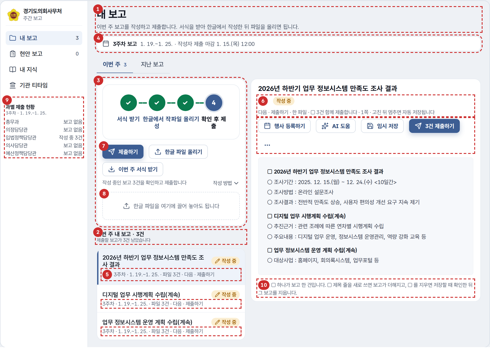 | 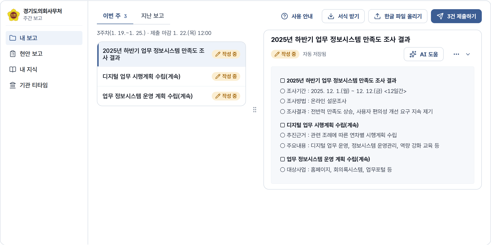 |

「전」은 여러 서비스의 개선 사례를 한 화면에 모아 **다시 만든 예시**다(실제 운영 화면의 캡처가 아니다). 자료는 전부 가상이다.
그림의 번호는 [`less.html`](design/examples/less.html) 아래 「무엇을 어디로 옮겼나」 표와 짝이고, 공통 규칙은 [덜어내기 가이드](docs/guides/less.md)의 R번호로 이어진다.
브라우저로 직접 바꿔 보려면 [이 주소](https://gyeonggi-council.github.io/ggc-design-system/design/examples/less.html)를 누른다(인터넷이 되는 PC·휴대폰).

## 이 저장소가 하는 일

- **화면 예제** — 버튼·표·메뉴·로그인 화면이 어떻게 생겼는지 실제 화면으로 보여 준다.
- **규칙** — 화면에 무엇을 두고 무엇을 덜어낼지, 어떤 말을 쓸지 정한다. 사용자 의견에서 나온 규칙이다.
- **복사해 쓰는 파일** — 서비스가 같은 색·글꼴·부품을 쓰도록 그대로 복사하는 파일 몇 개와, 잘 복사했는지 보는 검사기.

## 먼저 화면으로 보기

**가장 쉬운 방법 — 주소를 누른다**(인터넷이 되는 PC·휴대폰. 망분리 업무망 PC 에서는 열리지 않는다):

- 화면 예제 처음: <https://gyeonggi-council.github.io/ggc-design-system/design/examples/index.html>
- 덜어내기 전/후 바꿔 보기: <https://gyeonggi-council.github.io/ggc-design-system/design/examples/less.html>
- 실시간 회의 화면: <https://gyeonggi-council.github.io/ggc-design-system/design/examples/operate.html>

업무망 PC 처럼 인터넷이 안 되는 곳에서는 아래처럼 파일로 연다.

1. **파일 하나만 받으려면** [`design/examples/examples-standalone.html`](design/examples/examples-standalone.html)(합본)을 내려받아 브라우저로 연다. 모든 업무 화면 예제가 한 파일에 들어 있다(약 1.4MB, 인터넷 연결 없이 열린다). GitHub 파일 화면의 **Download raw file** 단추로 받는다.
2. **여러 파일로 된 원래 예제**를 보려면 저장소 전체를 내려받아(초록색 **Code → Download ZIP**) 압축을 풀고 [`design/examples/index.html`](design/examples/index.html)을 연다. 설치할 것은 없다.
3. GitHub 웹에서 HTML 파일을 그냥 누르면 화면이 아니라 글자(소스)로 보인다 — 위 두 방법 중 하나로 연다.

볼 만한 쪽: **덜어내기 전/후**(`less.html`) · **실시간 회의**(`operate.html` — 영상 아래 자막, 연결이 끊겼을 때) · **의안 목록**(`explore.html`) · **QR 로그인**(`login.html`).
예제의 이름·숫자·의안은 전부 가상이다.

## 화면을 만들 때 지키는 다섯 가지

1. **이 화면을 누가, 무엇을 하러 여는지 한 줄로 정한다.** 누를 일이 있으면 가장 중요한 단추 하나만 강조한다(읽기·시청 화면에는 없어도 된다).
2. **같은 정보는 한 번만.** 날짜·건수·상태를 제목, 띠, 목록, 오른쪽 칸에 되풀이하지 않는다. 단, 고른 문서가 무엇인지·무엇을 실행하는지 확인하는 표시는 남긴다.
3. **설명 문장과 단계 그림은 꼭 필요할 때만.** "여기서 …을 확인합니다" 같은 문장은 빼고, 처음 쓰는 사람용 안내는 [사용 안내] 단추 뒤에 둔다.
4. **화면 틀은 흔들리지 않는다.** 검색하거나 조건을 바꿔도 메뉴·검색창·단추 자리가 그대로다.
5. **판단에 필요한 것은 덜어내지 않는다.** 오류가 난 이유와 해결 방법, 저장됐는지, 밖으로 보내기 전 미리보기, AI 답의 출처, 낯선 말의 한 줄 풀이는 남긴다.

자세한 규칙 10개와 화면을 보고 판정하는 방법: [docs/guides/less.md](docs/guides/less.md) · 왜 이렇게 정했나: [ADR 0012](docs/decisions/0012-show-what-is-needed.md)

## 담당자는 이렇게 확인하고 의견을 낸다

1. 맡은 화면에서 **가장 자주 하는 일**을 한 문장으로 적는다. 예: "이번 주 보고를 올리고 제출한다".
2. 첫 화면에서 그 일에 필요한 **목록·문서·단추**를 찾아본다. 어디서 시작할지 바로 찾기 어렵다면, 찾으려던 일과 헷갈린 위치가 곧 의견이다.
3. 헷갈리는 곳은 화면을 캡처해 번호를 매기고 "**어디에서 무엇을 하려 했는지**"와 함께 보낸다. 실제 개선은 대부분 이런 캡처에서 나왔다.

색 이름이나 개발 용어를 몰라도 된다. "이건 뭐 하는 기능이야?", "이 줄은 필요 없어", "한 줄로"면 충분하다.

## 말 풀이

| 말 | 뜻 |
|---|---|
| 정본 | 원본. 값이 다르면 여기 있는 것이 맞다 |
| 토큰 | 색·글자 크기 같은 값에 붙인 이름(예: `--ggc-primary` = 의회 남색). 값은 파일 하나에만 적는다 |
| 컴포넌트 | 버튼·표·탭처럼 화면을 만드는 부품 |
| 갤러리 | 부품과 예제 화면을 모아 둔 곳(`design/examples/`) |
| 업무 / 대민 | 직원이 쓰는 화면 / 도민이 보는 공개 화면. 글자 크기와 화면 상단 구성이 다르다 |
| 검사기 | 서비스가 원본 파일을 그대로 복사했는지, 정해진 색만 쓰는지 기계로 보는 도구(`check_design.py`) |
| ADR | 결정 기록. "왜 그렇게 정했나"를 한 장씩 남긴 것(`docs/decisions/`) |
| 툴팁 | 아이콘에 마우스를 올리면 뜨는 짧은 이름표. 휴대폰에서는 안 보이므로 꼭 알아야 할 내용은 넣지 않는다 |
| 토글팁 | ⓘ 를 누르면 열리는 짧은 설명. 휴대폰에서도 열린다 |
| 정보 서랍 | 행 제목을 누르면 오른쪽에서 나오는 칸. 그 건의 담당 · 소관 · 시각 같은 자세한 정보를 보여 준다 |

---

## 여기부터 개발자용

화면을 직접 만드는 사람을 위한 내용이다. 용어는 위 「말 풀이」를 본다.

**v3.3 (2026-10-26)** ⚠ D1 — 핵심만 화면에, 보조 정보는 한 번 눌러서([ADR 0015](docs/decisions/0015-key-info-on-screen-details-on-demand.md)): 토글팁 `.ggc-toggletip` · 오른쪽 정보 서랍 `.ggc-modal--sheet` · 왼쪽 메뉴 완전 숨김(`data-ggc-lnb-collapse="hide"`, 기억) · 툴팁이 포인터를 옮겨도 닫히지 않게 · 부품 문서의 처방형 문장(「KPI 정확히 4」「열 다섯 필수」 등)을 조건형으로. **토큰 파일은 바뀌지 않았다** — 컴포넌트 CSS · 동작 JS 만 바뀌었다.
**v3.2 (2026-10-24)** ⚠ D1 — 면은 흰 바탕 + 테두리(GitHub 식) · 제목 굵기 600 · 상태 보이기 가이드([docs/guides/states.md](docs/guides/states.md)) · 서비스 부품 다섯(`.ggc-job` · `.ggc-solo` · `.ggc-signature` · `.ggc-viewer` · `.ggc-split`) · 검사기 판 표시 · 재복사 도구 `tools/sync-canon.py`. 이전 안내 [v3.1→v3.2](docs/migration/v3.1-to-v3.2.md) · ADR 0013.
**v3.1 (2026-10-18)** — 덜어내기 규칙([docs/guides/less.md](docs/guides/less.md))과 Operate(실시간 화면) 정본을 더했다. **CSS·토큰 파일은 바뀌지 않았다** — 서비스는 다시 복사할 필요가 없고, 그 화면을 다음에 고칠 때 규칙을 적용한다.
**v3.0.0 (2026-09-05)** — 업무 프로필이 **shadcn 기본 밀도**로, 제목은 본문으로, 아이콘은 lucide 로(ADR 0009 · 0010 · 0011).
타이포 스케일 토큰 신설, Tier 2 는 **shadcn 공식 소스 + 토큰** 74항목(sidebar · data-table · command · calendar · chart · sonner · form …),
대외 발표용 PPT 템플릿(`design/ppt/`). 11개 프런트엔드(Next 14/15/16 · React 18/19 · Vite · JSP/Tiles · Jinja2 · FastAPI · 정적 HTML)가 이 한 벌을 소비한다.
v2 소비자는 [docs/migration/v2-to-v3.md](docs/migration/v2-to-v3.md) 대로 정본 6파일을 재복사한다(⚠ D1). 진단은 [docs/audit/2026-09-05-shadcn-krds-audit.md](docs/audit/2026-09-05-shadcn-krds-audit.md).

## 갤러리 자세히 — `design/examples/`

**저장소를 내려받아 [`design/examples/index.html`](design/examples/index.html) 을
브라우저로 열면 된다.** 서버도 빌드도 패키지 설치도 필요 없다.
(GitHub 웹에서는 HTML 이 렌더되지 않고 소스로만 보인다.)

| 페이지 | 무엇을 보나 |
|---|---|
| [`index.html`](design/examples/index.html) | 개요 · 3분 도입 · 관통 원칙 · 접근성 |
| [`tokens.html`](design/examples/tokens.html) | 색 · 타이포 · 간격 · 형태 · 포커스 **전수**, 대비비 실측, 대민 프로필 토글 |
| [`components.html`](design/examples/components.html) | 버튼 · 배지 · 카드 · 통계 · 행리스트 · 표 · 폼 · 위저드 · 상태 3종 |
| [`components-forms.html`](design/examples/components-forms.html) | 셀렉트 · 체크/라디오/칩 · 스위치 · 날짜 · 파일 업로드 · 리스트박스 |
| [`components-nav.html`](design/examples/components-nav.html) | GNB 제목부 · 페이지 헤더 · 브레드크럼 · 탭 · 페이지네이션 · 아코디언 · 메뉴 · 링크 · 목차 |
| [`components-overlay.html`](design/examples/components-overlay.html) | 알림 · 토스트 · 모달 · 정보 서랍(v3.3) · 툴팁 · 토글팁(v3.3) · 스피너 · 스켈레톤 · 빈 상태 · 액션바 |
| [`dashboard.html`](design/examples/dashboard.html) · [`explore.html`](design/examples/explore.html) · [`wizard.html`](design/examples/wizard.html) · [`login.html`](design/examples/login.html) | 실물 업무 화면 — Monitor · Explore(v3 신설) · Configure · QR 로그인 |
| [`less.html`](design/examples/less.html) · [`operate.html`](design/examples/operate.html) | **v3.1** — 같은 화면의 덜어내기 전/후 · Operate(실시간 시청 · 반복 처리 작업대) |
| [`workbench.html`](design/examples/workbench.html) · [`public/solo.html`](design/examples/public/solo.html) | **v3.2** — 두 칸 작업대(목록 + 한글 보기 + 긴 작업 진행) · 휴대폰 1인 링크 화면(서명 전체 화면 창) |
| [`public/index.html`](design/examples/public/index.html) 외 4쪽 | **대민 셸** — 마스트헤드 · 헤더 · 주 메뉴 · 공개 푸터 · 아이덴티파이어 (KRDS 패턴 + 기관 CI) |

**파일 하나로 열고 싶으면** `design/examples/examples-standalone.html` 을 쓴다 —
생성기에 등록된 업무 예제 전부(지금 12쪽)와 정본 CSS·JS·의회 마크·글꼴을 한 파일에 인라인한 **생성물**(약 1.4MB)이고
**외부 요청이 0** 이라 망분리 환경과 오프라인에서도 그대로 뜬다. 링크로 공유할 때 쓴다.
손으로 고치지 말 것 — `build-standalone.py` 가 정본에서 다시 만든다.

갤러리는 **정본을 상대경로로 직접 링크한다.** 사본을 두지 않으므로 정본의
스모크 테스트이기도 하다 — 실제로 이걸 만들면서 정본 결함 두 개를 찾았다
(`.ggc-gnb-brand` 가 링크일 때의 밑줄, `.ggc-wizard-mini` 의 가로 오버플로).
자세한 규칙은 [`design/examples/README.md`](design/examples/README.md).

## 관통 원칙 — 이름은 복제해도 되고, 값은 복제하면 안 된다

이 조직에서 값 복제는 **이미 실패한 실험**이다. 계약 문서가 선언한 `success` 값이
실물 CSS 와 두 달간 어긋난 채 아무도 그 갭을 보지 않았다.

- **토큰 이름**(`--ggc-primary`)은 소비자와의 인터페이스 → 문서가 색인해도 안전
- **값**(`#3c5d93`)은 구현 → **`design/ggc-tokens.css` 한 곳에만** 산다

값이 필요하면 그 파일을 연다. 문서에 값을 적는 순간 그 줄은 낡기 시작한다.

## 빠른 시작

```bash
# 1. 정본 파일을 복사한다. 손으로 옮겨 적지 않는다 — 바이트 동일이어야 검사가 성립한다
#    (토큰은 필수, 나머지는 쓰는 만큼. 대민 화면이면 ggc-public.css 까지)
cp design/ggc-tokens.css design/ggc-components.css design/ggc-behaviors.js design/ggc-icons.svg <서비스>/<정적루트>/

# 2. 자기 스타일보다 먼저 로드한다. 순서가 곧 우선순위다
#    <link rel="stylesheet" href="ggc-tokens.css">
#    <link rel="stylesheet" href="ggc-components.css">
#    <link rel="stylesheet" href="app.css">   +   <script src="ggc-behaviors.js" defer>

# 3. 브랜드 자산을 복사한다 (대상 경로는 design/brand/ASSET-MAP.tsv 가 고정)
cp design/brand/dist/favicon-32.png <서비스>/<정적루트>/

# 4. 검사한다
python design/check_design.py --report <서비스경로>
```

대민(공개) 화면은 `<html data-ggc-profile="public">` 한 줄로 KRDS 치수가 켜진다 — 마크업은 같다.

**패키지가 아니라 복사다.** 프런트가 7종이라 CSS 커스텀 프로퍼티가 최소공배수이고,
npm 워크스페이스·사설 레지스트리가 0건이다.

React · Next · Vite + Tailwind v4 프로젝트는 **Tier 2 — shadcn 레지스트리**로 같은 것을 복사 설치한다
(v2.0). npm 배포가 아니라 `public/r/*.json` 정적 파일이며, 색은 전부 `var(--ggc-*)` 라 값의 원천은 그대로 토큰 파일 하나다.

```bash
# components.json 의 registries 에 "@ggc": "<서빙주소>/public/r/{name}.json" 을 넣고
npx shadcn add @ggc/ggc-style -y      # 토큰 파일 + 테마 매핑 + P0 UI 35종 (shadcn 공식 소스 + 토큰, v3)
npx shadcn add @ggc/ggc-shell @ggc/ggc-page-head @ggc/ggc-data-table   # 사이드바 셸 · 제목 · TanStack 표
```

절차와 손으로 하는 셋(토큰 @import + `shadcn/tailwind.css` · 폰트 복사 · .dark 삭제)은 [docs/quickstart/react-tier2.md](docs/quickstart/react-tier2.md).

## 무엇이 들어 있나

| 경로 | 무엇 |
|---|---|
| `design/ggc-tokens.css` | **토큰 정본 v3.2** — 색·서체·간격·형태·포커스·셸·컨트롤 치수(shadcn 기본 밀도)·**타이포 스케일·아이콘 치수** + 대민 프로필 블록(KRDS) |
| `design/ggc-components.css` | 컴포넌트 v3.3 — 셸(경로부 · 아이콘 사이드바 · 접힘 · 완전 숨김) · 정보 서랍 · 토글팁·페이지 헤더(h1 본문)·카드·버튼·표·폼·위저드 … §37(제목 유틸 · 아이콘) |
| `design/ggc-icons.svg` + `design/icons/lucide/` | **아이콘 정본 v3.0** — lucide 부분집합 90종 스프라이트(생성물, `build-icons.py`). 이모지 금지 |
| `design/ppt/` | **대외 발표용 PPT 템플릿**(생성물 — 토큰에서 `build-ppt.py`) · 레이아웃 10종 · 샘플 12장 · [docs/guides/ppt.md](docs/guides/ppt.md) |
| `design/ggc-fonts.css` + `design/fonts/` | **폰트 정본 v1.0** — @font-face 하나와 가변 woff2 하나. 두 파일을 같은 폴더에 나란히 두고 토큰보다 먼저 링크한다 |
| `design/check_design.py` | **검사기** — `diff -q` 를 대체하는 6종 검사 |
| `design/brand/` | 파비콘 세트 · 의회 마크 · stdlib 전용 생성기 · 배포 매핑표 |
| **`design/examples/`** | **예제 갤러리 18쪽**(업무 13 + 대민 5) — 빌드 없이 열리는 실물. 여기부터 보면 된다 |
| `design/ggc-public.css` + `design/ggc-behaviors.js` | **대민 셸 v3.2**(마스트헤드·헤더·주 메뉴·공개 푸터·아이덴티파이어) · 공통 동작(탭·모달·drawer·대민 메뉴·토스트·드롭다운·파일·툴팁·리스트박스·목차) |
| `design/components.tsv` | **컴포넌트 인벤토리 정본** — 문서·DESIGN.md·레지스트리 lint 가 이 표를 읽는다 |
| `registry.json` · `registry/ggc/` · `public/r/` | **Tier 2 shadcn 레지스트리 74항목** — shadcn 공식 소스 + 토큰(UI 45 · 블록 27 · 훅). `registry.json` 은 생성물(`tools/build-registry-json.py`). 검사는 `tools/check-registry.py` |
| `DESIGN.md` | **생성물** — Claude Design 「디자인 시스템 가져오기」가 읽는 루트 문서 (`tools/build-design-md.py`) |
| `skills/ggc-design/` | **디자인 가이드 본문** — 화면 처방·스택별 착지점·리스킨·검증 |
| `docs/contract.md` | 단일 디자인 계약 (AUTHORITATIVE) |
| `docs/guides/less.md` | **덜어내기** — 화면에 무엇을 언제 보이나(v3.1, ADR 0012) |
| `docs/krds-alignment.md` | **KRDS 정렬** — 무엇을 따르고 무엇을 오버라이드하는가 |

## 가이드 읽는 순서

0. **[design/examples/index.html](design/examples/index.html)** — 먼저 눈으로 본다.
   글로 읽기 전에 무엇이 나오는지 알면 나머지가 훨씬 빨리 읽힌다
1. **[docs/README.md](docs/README.md)** — 사람용 문서 진입: 내 스택의 5단계 quickstart · 업무/대민 판정 · 컴포넌트 찾기
2. **[skills/ggc-design/SKILL.md](skills/ggc-design/SKILL.md)** — Claude Code 스킬 (전체 절차 · 결정 트리 · 완료 체크리스트).
   설치는 `bash tools/install-skill.sh` — 링크라 복사본이 생기지 않는다
3. [docs/guides/less.md](docs/guides/less.md) — **덜어내기**(v3.1). 화면을 다 짠 뒤 「군더더기 열 가지」부터 대 본다
4. [docs/contract.md](docs/contract.md) — AUTHORITATIVE 계약
5. [skills/ggc-design/references/](skills/ggc-design/references/) — contract · profiles · archetypes · public-patterns · components · porting · registry · verify

## 검사기

```bash
python design/check_design.py --canon                 # 정본 자체 (문서↔파일 갭)
python design/check_design.py --report <서비스경로>    # 판정만
python design/check_design.py --gate   <서비스경로>    # FAIL 이면 exit 1
python design/check_design.py --all    <서비스루트>    # 전수 요약
bash tools/check-all.sh                                # 이 저장소 자체 전수 (CI 가 도는 것과 같다)
```

| ID | 검사 | 왜 필요했나 |
|---|---|---|
| D1 | 정본 6파일 사본 바이트 동일 (tokens · components · public · fonts · behaviors · icons) | |
| **D2** | 색 리터럴이 허용집합 안인가 | `diff -q` 는 **값을 인라인 이식한 서비스를 원리상 판정 못 한다** |
| D3 | 로드 순서 · 공통 셸 · 파비콘 | 순서 역전은 "왜 색이 안 먹지" 로만 나타난다 |
| D4 | 외부 폰트 CDN 0 | 망분리에서 깨진다 |
| D5 | `:focus-visible` · 대체 없는 `outline:none` · 대비 | |
| D6 | **정본 자체** — 계약 문서 ↔ 토큰 ↔ 컴포넌트 ↔ 인벤토리 ↔ 생성물 · 프로필 블록 | 갭이 두 달간 안 보였다 |
| D7 | Tier 2 소비 프로젝트 — 토큰 `@import` · `:root` 매핑이 전부 `var(--ggc-*)` · 다크 팔레트 없음 | 값을 두 번 적는 순간 갈라진다 |

검사기는 **설명을 위반으로 세지 않는다.** 주석과 HTML `<code>`/`<pre>` 본문은 스캔에서
제외한다 — 그러지 않으면 “`#256ef4` 는 폐기값” 이라고 적는 순간 그 문장이 FAIL 이 되어
**규칙을 문서화할수록 FAIL 이 늘어난다.** D5 의 포커스 검사는 `<link>` 로 부르는
로컬 CSS 까지 따라간다(사본 무결성은 D1 이 따로 본다).

허용집합은 **매 실행 시 정본 CSS 에서 파생**한다. 락파일을 만들지 않는다 —
락파일은 "정본과 같아야 하는 파일" 을 하나 더 만드는 것이고, 그게 지금 문제의 형태다.

예외는 코드 옆에서 사유와 함께 등록한다:

```css
/* ggc-design-allow: #13778e — 표창관리 이관 브랜드. 리스킨 대기 */
```

## 접근성

토큰 v1.2 는 **WCAG AA(4.5:1)** 를 통과한다. v1.1 은 자기 자신이 미달이었고
(상태색 4종이 자기 틴트 위에서 3.65~3.83:1, 배지 7종 전부), 경기도의회는 공공기관이라
KWCAG 2.2 가 법적 준수 대상이다.

값과 무관하게 지키는 것 — **색 단독 의존 금지**(배지에 텍스트·아이콘 병기) ·
`--ggc-text-faint` 를 텍스트에 쓰지 않기 · 링크에 밑줄 · `:focus-visible` 가시 링 필수 ·
placeholder 를 유일한 라벨로 쓰지 않기.

**고대비**는 토큰이 처리한다 — 서비스가 따로 만들 것이 없다.

- `forced-colors: active` (**Windows 고대비 테마**) — OS 가 색을 갈아끼우므로 팔레트를
  정의하는 게 아니라 **깨지지 않게** 한다. ⚠ 이 모드에서 `box-shadow` 는 렌더되지 않아
  **포커스 링이 통째로 사라지고 있었다**(WCAG 2.4.7). `outline` 으로 복원했고,
  배경색만으로 구분되던 배지·활성 내비·합계행에 테두리를 보장했다.
- `prefers-contrast: more` — 색 반전 없이 중립을 한 단계 진하게, 링을 두껍게.

**새 토큰 이름도 두 번째 팔레트도 만들지 않았다.** KRDS 의 `mode-high-contrast` 는
밝은 글자를 쓰는 사실상 다크 테마라 따르지 않았다 — 계약이 비범위로 둔 다크모드를
우회 도입하게 되고 토큰 표면이 2배가 된다. 근거는
[docs/krds-alignment.md §7](docs/krds-alignment.md).

## 정부 표준(KRDS)과의 관계

**기반이지만 그대로 채택하지는 않는다.** 브랜드 색은 기관 CI 로 오버라이드하고
(KRDS 가 전제하는 사용법이다), 간격 스케일은 KRDS 부분집합으로 일치하며,
상태색·중립 램프·컨트롤 높이는 갈린다.

**업무 프로필에서 KRDS 는 접근성 바닥만**(v3.0, ADR 0009) — 치수(48/17)·셸(마스트헤드·아이덴티파이어)·컴포넌트 마크업 참조는 대민 프로필에만.
KWCAG 2.2 AA · `:focus-visible` · forced-colors · ARIA 는 「장애인차별금지법」상 내부 시스템에도 적용되므로 유지한다. 표는 [docs/krds-alignment.md §9](docs/krds-alignment.md).

상태색은 **KRDS 로 수렴하지 않기로 결정했다**(2026-08-22). CIELAB 색차로 확인하니
v1.2 가 AA 를 통과하는 값 중 **디자인 원본에 가장 가까운 집합**이고(ΔE 5.7~10.1,
색상각 Δ0~2°), KRDS 값은 대비가 0.5~0.7 좋아지는 대신 경기도의회 CI 톤에서 멀어진다.
**기관 CI 유지가 우선**이다.

전부 실측 대조해 [docs/krds-alignment.md](docs/krds-alignment.md) 에 적었다.
**정부 표준 완전 준수를 주장하지 않는다.**

## Claude Design 에서 쓰기

시안은 Claude Design(claude.ai/design)에서, 반영은 이 저장소의 토큰·컴포넌트로 한다.
시안이 처음부터 의회 디자인으로 나오게 하려면 **디자인 시스템을 먼저 가져온다** —
둘 중 하나면 된다.

1. Claude Design 의 「디자인 시스템 가져오기」에 이 저장소 URL 을 붙인다. 루트의
   [`DESIGN.md`](DESIGN.md) 를 읽는다.
2. 또는 `DESIGN.md` 파일을 「Create new design system → Add assets」에 올린다.

`DESIGN.md` 는 **생성물**이다 — 값은 `design/ggc-tokens.css` 에서, 컴포넌트 목록은
`design/components.tsv` 에서 온다. 손으로 고치지 않는다. 토큰이나 인벤토리가 바뀌면
`python tools/build-design-md.py` 로 다시 만들고, 낡으면 `check_design.py --canon` 이 잡는다.

> Claude Design 산출물을 그대로 배포하지 않는다. 시안 코드에는 외부 CDN 참조나 규약 밖
> 색이 섞일 수 있다 — `skills/ggc-design/references/porting.md` 의 역변환 규칙대로 옮긴다.

## 이 저장소의 지위

**이 저장소가 정본이다** (2026-08-29 승격). 값의 유일한 원천은 `design/ggc-tokens.css` 이고,
모든 서비스 사본·문서·생성물이 여기서 파생한다. 과거에는 상위 플랫폼 저장소
(`ggc_ai_platform`)가 정본이고 여기가 공유용 배포판이었다 — 그 시기의 동기화 도구와
구판 문서는 [`archive/`](archive/) 에 보존돼 있다.

**브랜드 아이덴티티는 여기가 아니다.** CI 원본 색 · 로고 파생 · 열람용 가이드 사이트는
별도 저장소 `ggc-design-guide` 가 정본이다(2026-08-30 결정). 대외 발표용 PPT 템플릿은 **토큰의 생성물**이라 여기 `design/ppt/` 에 있다(2026-09-05). 이 저장소는 그 색을 **구현 토큰**
(`design/ggc-tokens.css`)으로 갖고, 두 저장소의 값이 갈리면 그쪽의 `tools/check_drift.py` 가 잡는다.
브랜드 색을 바꾸는 결정은 그쪽에서 나고 여기로 내려온다.

**Claude Design 의 「경기도의회 공통 디자인 시스템」 프로젝트는 정본이 아니다.**
그쪽은 시안·프로토타입을 만들기 위한 **파생판**이고, 값이 갈리면 이 저장소가 이긴다.
그쪽에서 새로 만들어진 것이 생기면 **이 저장소에 먼저 반영한 뒤** 쓴다 —
반대 방향으로 흐르지 않는다. 검사기가 이 저장소의 파일만 정본으로 보고,
망분리된 서버는 claude.ai 에 접근하지 못하기 때문이다.

## 참고 시안 — 의안 스튜디오 2.0 B안

> **공통 기준이 아니다.** 한 서비스(의안)의 개편을 검토하려고 등록한 참고 자료다. 이 시안의 단계 안내·대시보드 구성을
> 다른 서비스의 기본형으로 옮기지 않는다 — 공통 기준은 위 「화면을 만들 때 지키는 다섯 가지」와 [덜어내기](docs/guides/less.md)다.

의안 작성부터 심의·의결·이송·공포까지의 업무 흐름과 도민용 화면을 검토하는
**독립 실행형 디자인 참고 시안**이다. 네이비 사이드바, 문서 중심 작업 영역, 단계별 진행 안내를
기준으로 실제 UI 개편을 요청한다. 기존 디자인 시스템의 정본이나 운영 서비스를 대체하는 코드는 아니다.

| 자료 | 용도 |
|---|---|
| [B안 참고 HTML](docs/design-evidence/ggc-legislative-studio-v2.html) | 업무·도민 화면과 주요 처리 흐름을 브라우저에서 확인 |
| [상세 적용 요청서](docs/design-evidence/legislative-studio-v2-implementation.md) | 메뉴 매핑, 구현 범위, 보존 조건, 검증·마이그레이션 기준 |
| [디자인 구현 이슈 #5](https://github.com/gyeonggi-council/ggc-design-system/issues/5) | 실제 UI 개편 작업과 완료 조건 추적 |
| [참고자료 PR #6](https://github.com/gyeonggi-council/ggc-design-system/pull/6) | 참고 시안·적용 명세·README 안내의 변경 내역 |

### 시안 확인 방법

1. 위 **B안 참고 HTML** 파일을 내려받아 브라우저로 연다. 서버·빌드·패키지 설치는 필요 없다.
2. GitHub 파일 보기에서는 HTML이 실행되지 않고 소스로 표시된다. 파일 화면의 **Download raw file**을 이용한다.
3. 가상 데이터로 화면과 흐름을 확인한다. 입력 내용은 브라우저의 `localStorage`에 저장될 수 있으므로
   개인정보·민감정보·운영 데이터는 입력하지 않는다.

### 실제 서비스 적용 시 구분할 사항

- **참고자료 등록과 실제 디자인 구현은 별개다.** 이 자료나 README의 추가만으로 운영 UI 적용이 완료되는 것은 아니다.
- HTML을 통째로 덮어쓰지 않고 기존 토큰·공통 컴포넌트로 재구성한다. 기존 업무 로직·데이터·경로·API·인증·권한은 보존한다.
- 가상 데이터와 `localStorage`, 모의 서명·AI·접수·알림·외부 연계는 시연용이다. 운영 기능은 별도로 구현·연결·검증한다.
- 데스크톱·390px 모바일·키보드 접근성과 기존 테스트를 검증하고, 별도 구현 브랜치와 PR로 제출한다. `main` 직접 변경·자동 병합·운영 자동 배포는 하지 않는다.
- ISP PPT 원본·내부 자료·자격증명은 공개 저장소에 포함하지 않는다.

### B안 실제 화면 캡처

<details>
<summary>B안 캡처 펼쳐보기 (PC 4장 · 모바일 3장)</summary>


아래는 [의안 스튜디오 2.0 B안 원본](docs/design-evidence/ggc-legislative-studio-v2.html)을
**가상 데이터 초기 상태에서 실행하여 새로 캡처한 화면**이다. 운영 서비스 적용 완료 화면이 아니다.
업무용 화면과 도민용 화면을 구분했으며, 기존 정본 컴포넌트 이미지는 아래의 접힌 참고 영역에 남겼다.
[캡처 기준·화면 경로](docs/design-evidence/screenshots/README.md)

### PC 화면 · 1440 × 900

**오늘의 의정: 대시보드와 이어서 작업하기**

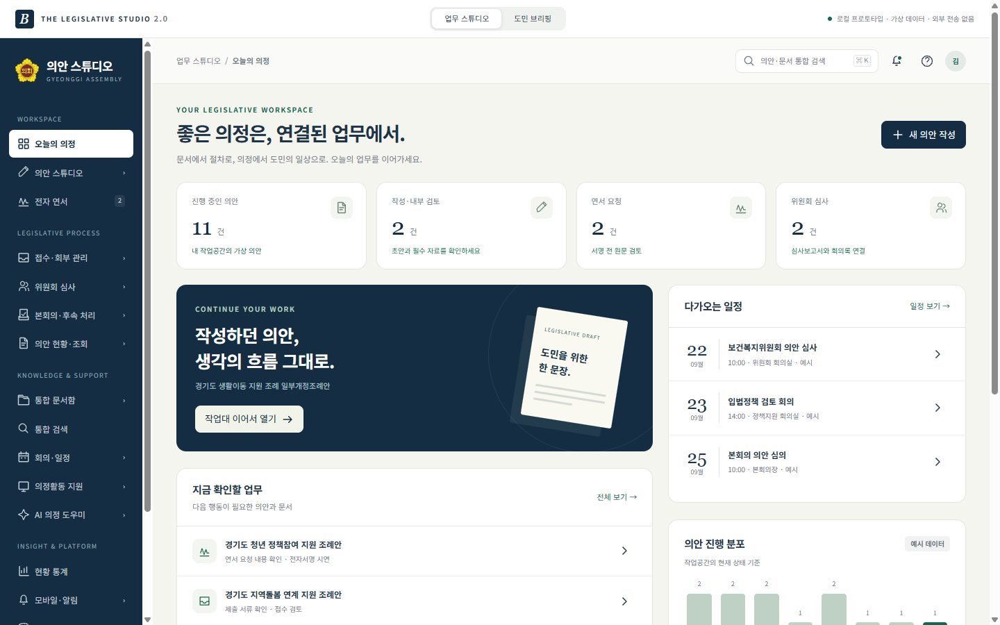

**의안 현황·조회: 검색·상태 필터와 의안 목록**

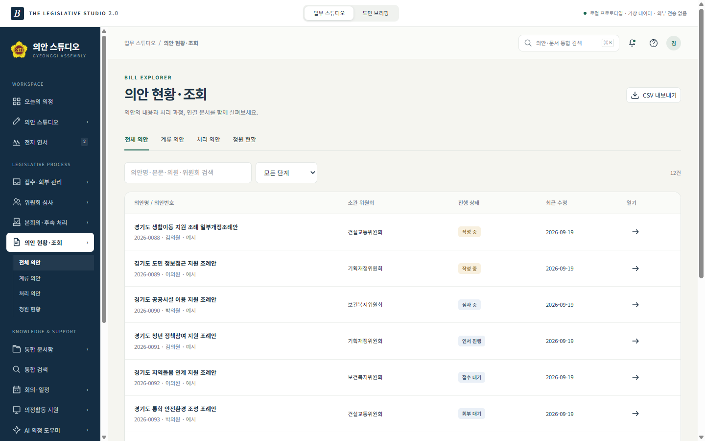

**문서 작업대: 초안 편집·처리 단계·다음 절차 안내**

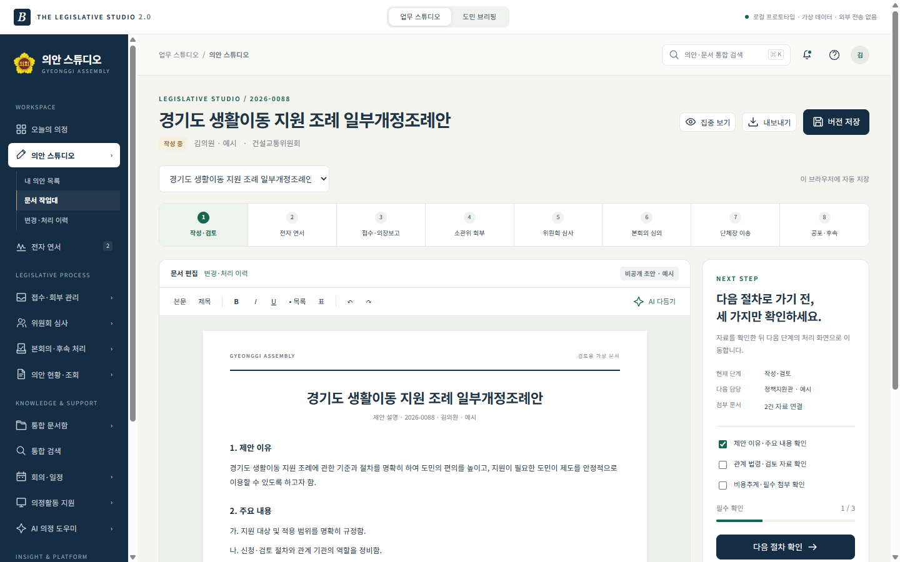

**도민 브리핑: 공개 예시 의안과 생활 중심 설명**

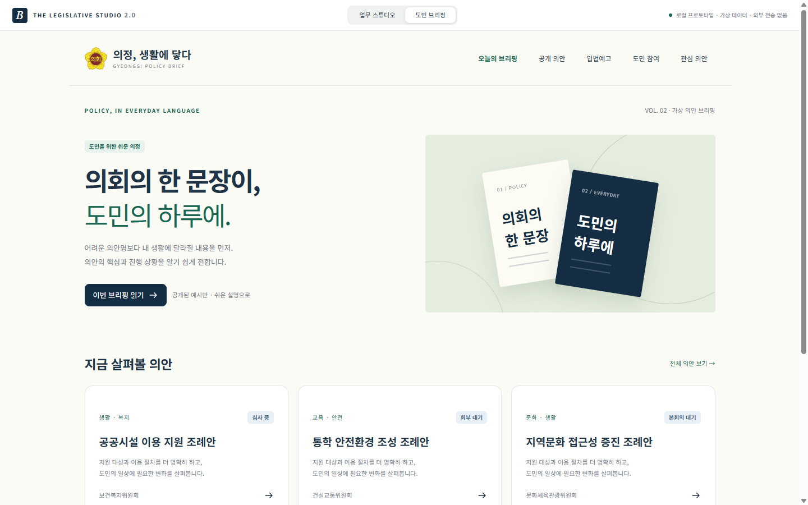

### 모바일 화면 · 390 × 844

| 오늘의 의정 | 의안 현황·조회 | 문서 작업대 |
|---|---|---|
| 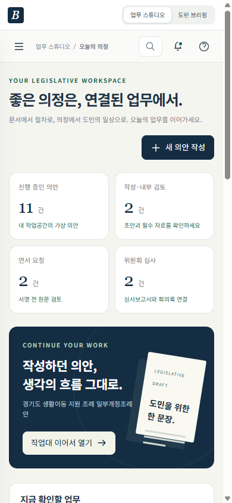 | 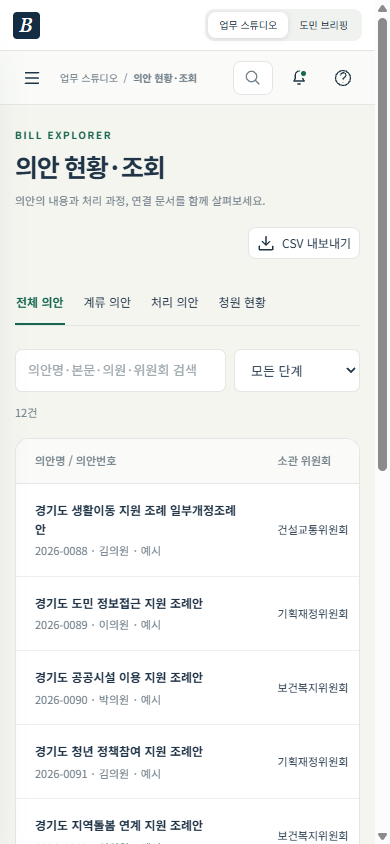 | 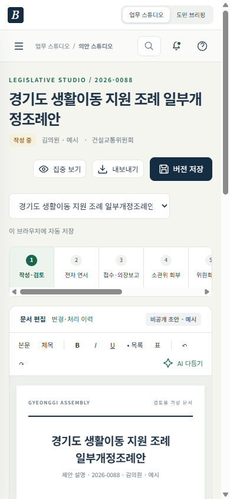 |

모바일은 실제 390px 뷰포트의 첫 화면이다. 긴 목록·문서는 세로로, 넓은 표·처리 단계는 가로로 스크롤하여 확인한다.
전체 화면과 동작은 참고 HTML을 내려받아 확인한다.

</details>

## 기존 정본 컴포넌트 (별도 참고)

아래 이미지는 현재 정본 디자인 시스템의 컴포넌트 자료이며, 위 B안 화면과는 구분된다.
참고 시안의 추가만으로 토큰·컴포넌트·기존 예제가 변경된 것은 아니다.

<details>
<summary>기존 정본 팔레트와 컴포넌트 펼쳐보기</summary>

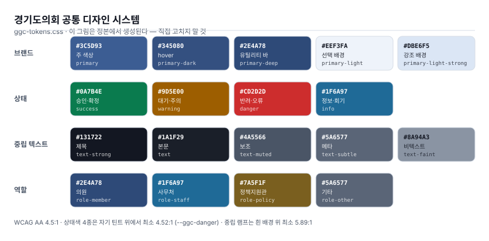

> 위 그림은 **정본에서 생성된 것**이다(`design/examples/build-preview.py`).
> 값을 옮겨 적지 않았고, 토큰이 바뀌면 다시 생성해야 하며,
> 낡으면 `check_design.py --canon` 이 잡는다.

컴포넌트 이미지는 `design/examples/` 갤러리를 `design/examples/build-shots.py`로 캡처한 생성물이다.
정본 CSS·갤러리가 바뀌면 기존 빌드 도구로 다시 생성하며, `check_design.py --canon`으로 검사한다.
[기존 갤러리](design/examples/index.html) · [기존 반응형 개선 기록](docs/audit/2026-09-15-responsive-ux-review.md) · [업무 배치 적용](docs/components/work-layout.md)

### 컴포넌트

| 페이지 헤더 `.ggc-page-head` — 제목은 본문에(ADR 0010) · 기본형/간결형, 설명과 주 단추는 필요할 때만(v3.1) |
|---|
| 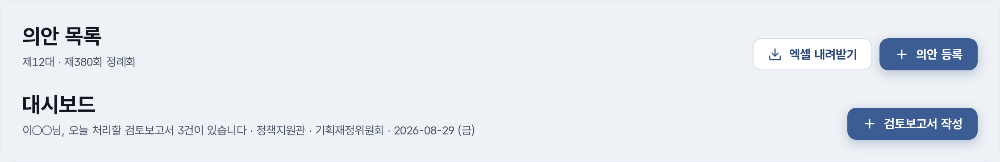 |

| GNB 경로부 `.ggc-gnb-page` — 브레드크럼만 |
|---|
| 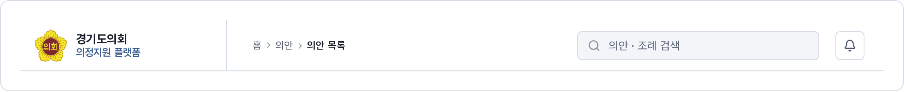 |

| 버튼 `.ggc-btn` | 배지 · 태그 `.ggc-badge` `.ggc-tag` |
|---|---|
| 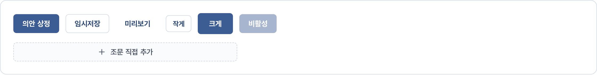 | 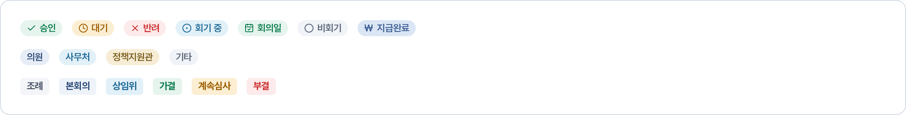 |
| **카드 `.ggc-card`** | **통계 타일 `.ggc-stat`** |
| 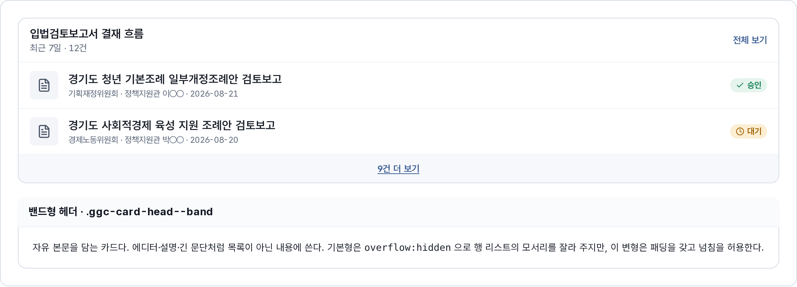 | 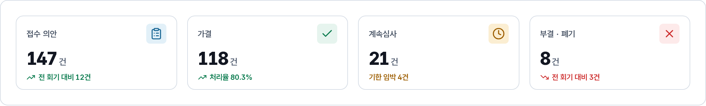 |
| **표 `.ggc-table`** | **위저드 `.ggc-wizard`** |
| 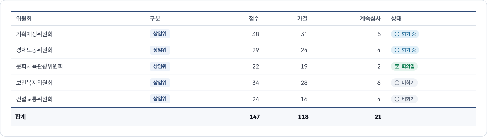 | 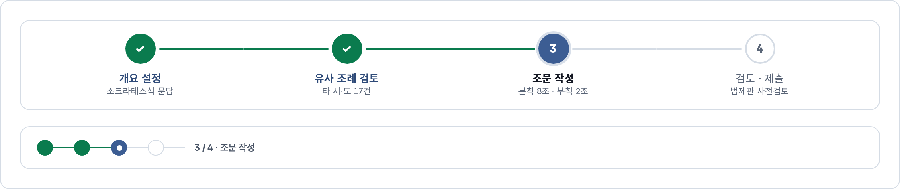 |
| **Explore 필터 스트립 (조립)** | **체크박스 · 라디오 `.ggc-check` `.ggc-radio`** |
| 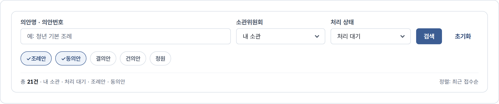 | 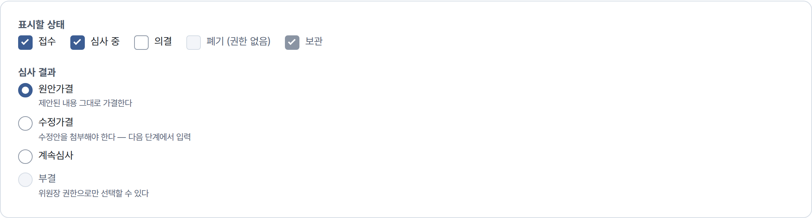 |
| **탭 `.ggc-tabs`** | **페이지네이션 `.ggc-pagination`** |
| 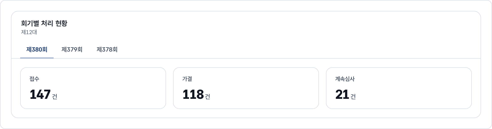 | 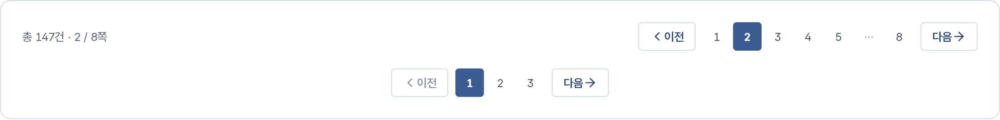 |
| **알림 · 콜아웃 `.ggc-alert`** | **빈 상태 · 오류 · 로딩** |
| 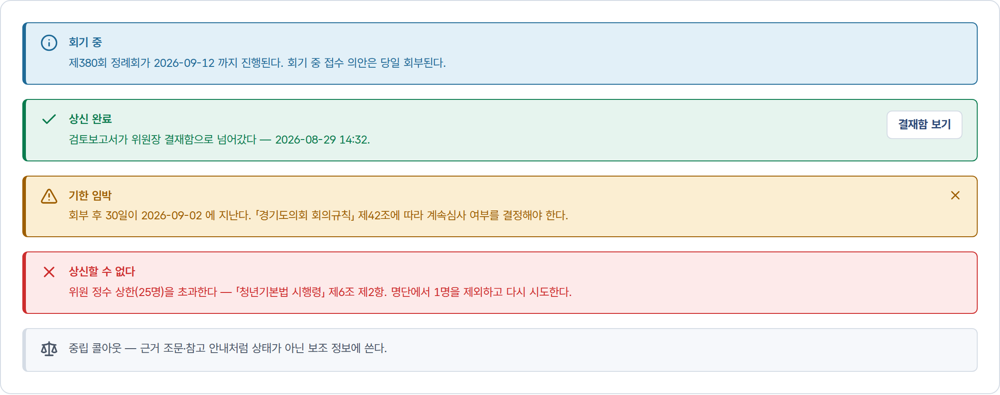 | 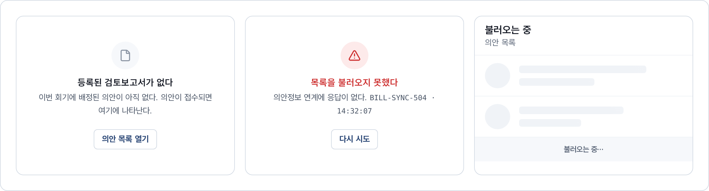 |

</details>

## 공개 이력과 남은 주의점

2026-08-26 에 이력을 **orphan 커밋 하나로 재생성**해 public 으로 전환했다(「공개판」).
서비스 소스·k8s 매니페스트·DB 스키마는 애초에 들어 있지 않고, 예제 갤러리의
의안명·숫자·이름·날짜는 전부 가상이다(위원회 이름만 공개 정보, 사람 이름은 `이○○` 마스킹).
인프라 주소는 마스킹돼 있고, `.gitignore` 가
`.env`·`*.pem`·`*.key`·`*-jwk.json`·`.mcp.json`·kubeconfig 를 막는다.

2026-08-30 에 과거 blob 에 남아 있던 원문 IP 를 `git filter-repo` 로 **전체 이력에서 치환**하고
전 브랜치를 다시 밀었다(커밋 해시가 그때 전부 바뀌었다). 그 이전 해시를 참조하는 외부 기록은 낡은 것이다.

공개 상태에서 계속 지킬 것 —
- **마스킹을 되돌리는 커밋을 만들지 않는다.** `python tools/check-links.py` 가
  절대경로(`D:\`·`/d/…`)와 원문 IP 패턴을 문서·코드 전반에서 잡는다.
- **의회 마크 외의 CI 자산은 넣지 않는다.** 가로조합 로고 3판·축약 로고·슬로건은
  기관의 대외 배포 판단이 나기 전까지 보류한다(슬로건은 신영복 선생 캘리그래피 기반이라
  마크와 별개의 판단이 필요하다).

## 라이선스·자산

의회 마크(`design/brand/assembly-mark.png`)는 경기도의회 공식 홈페이지가 OG 이미지로
쓰는 파일이다. 출처와 파생 근거는 [design/brand/SOURCE.md](design/brand/SOURCE.md).

Pretendard GOV 1.3.9 가변은 **SIL Open Font License 1.1** 이며 원문을
[design/fonts/OFL.txt](design/fonts/OFL.txt) 에 함께 배포한다 — 재배포 시 이 파일을 유지한다.
예약 서체명("Pretendard")은 수정본에 쓸 수 없다.

자체 호스팅한다. **외부 CDN 을 링크하지 않는다** — 망분리 환경에서
요청이 나가지 않아 글꼴이 폴백으로 떨어진다.
